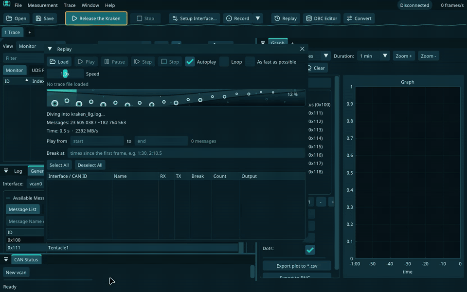

#  Kraken Explorer: Day of the N2K Tentacle

_"Deeper than a Peak. Wireshark is stuck in shallow waters."_

Open-source CAN / CAN FD / LIN / NMEA 2000 bus analyzer for Linux, Windows and macOS. Dear ImGui
GUI in a deep-sea dark theme, GPL-2.0, fork of [CANgaroo](https://github.com/Schildkroet/CANgaroo).

[](docs/demo.mp4)

▶ [Demo video (1:36)](docs/demo.mp4): an 8 GB log (183 million frames) opens in 4 s, then the file
in the trace, the Ctrl+P signal finder, Value Search, replay with breakpoints and Step, and live
DBC-decoded traffic on `vcan0`.

## Install

Packages are on the [latest release](https://github.com/stoffej/kraken-explorer/releases/latest) page.
Every install checks for a new release at start and once a day: the menu bar shows **Up to date**,
or **Update x.y.z**, and the AppImage and the Windows installer update themselves from there.

**Linux (any distribution)** — installs the AppImage in `~/.local/bin` with a menu entry, and on
Ubuntu / Debian the SocketCAN polkit rule and the `netdev` group (sudo asks once; log out and back
in if prompted):

```bash
curl -fsSL https://raw.githubusercontent.com/stoffej/kraken-explorer/main/scripts/get.sh | sh
```

Or download the AppImage yourself (`chmod +x`, run it); it updates itself in place wherever it is.
The `.deb` is still built (`sudo apt install ./kraken-explorer_*_amd64.deb`, polkit rule, icon and
menu entry included) but updates by hand: the app only points at the release page.

**Windows** — run the `...-win64-setup.exe` installer: the app then downloads the next installer
itself and runs it when you choose **Install and restart**. The portable `...-win64.zip` (unzip,
start `kraken-explorer.exe`) updates by hand. The binaries are not code-signed, so SmartScreen
warns on first run: **More info → Run anyway**. Packages are built unmodified from this repository
by [GitHub Actions](.github/workflows/cmake.yml); build from source if in doubt.

**macOS** (Apple silicon) — open the `...-macos-arm64.dmg` and drag **Kraken Explorer** onto
Applications; it updates by hand from the release page. The app is not notarized, so macOS refuses
the first start: **System Settings › Privacy & Security › Open Anyway**. PEAK adapters need
MacCAN's [PCBUSB library](https://mac-can.github.io/drivers/libPCBUSB.html).

Privacy: the program transfers nothing to other networked systems unless you ask it to, except the
update check (one request for the latest release to api.github.com; off with Settings > Updates or
`KRAKEN_UPDATE_CHECK=0`); the REST API (`--api PORT`) listens on 127.0.0.1 and only when started
with that flag.

## Build from source

One-liner (installs build dependencies, builds a `.deb` and installs it):

```bash
git clone https://github.com/stoffej/kraken-explorer && cd kraken-explorer && scripts/install.sh
```

By hand, build and run in place:

```bash
cmake -S . -B build -G Ninja && cmake --build build --target kraken-explorer
build/src/kraken-explorer
```

Or, after building, create and install a `.deb`:

```bash
scripts/build_deb.sh && sudo dpkg -i build/deb/kraken-explorer_*.deb
```

Running the binary without the `.deb`? SocketCAN link control needs the polkit rule, one line to install (log out and back in once for the group; re-run the `cp` after pulling, the rule only matches the `ip link` command lines of the matching build):

```bash
sudo cp packaging/10-kraken-explorer-socketcan.rules /usr/share/polkit-1/rules.d/ && sudo usermod -aG netdev $USER
```

On macOS (Xcode command line tools, [Homebrew](https://brew.sh) and Python 3.14 from
[python.org](https://www.python.org/downloads/macos/)), build the `.app` and open its DMG:

```bash
brew install cmake ninja pkg-config libusb pybind11 && scripts/build_macos_app.sh && open build/macos/kraken-explorer-*.dmg
```

Interfaces, features, dependencies and permissions: [docs/manual.md](docs/manual.md).
