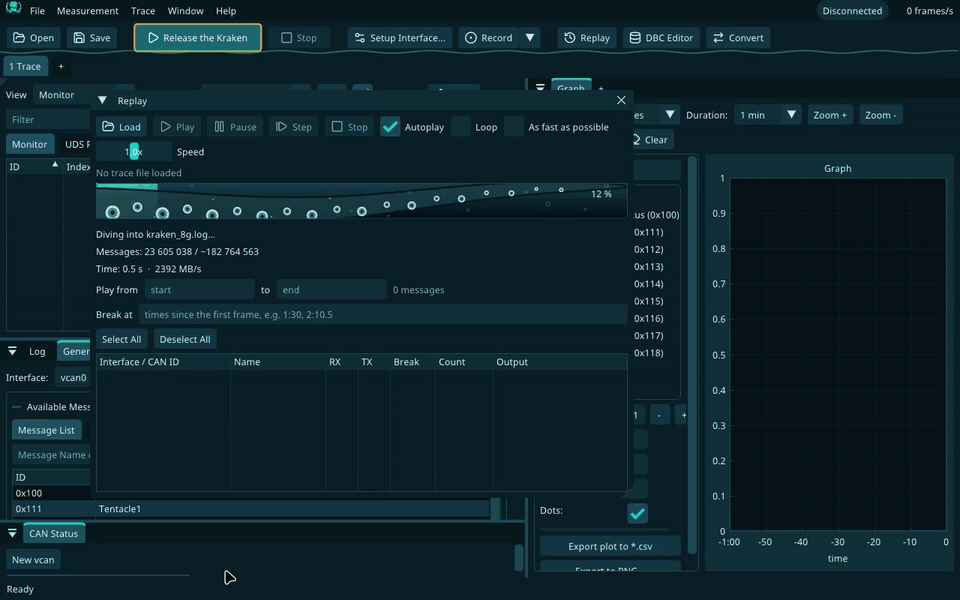

#  Kraken Explorer: Day of the N2K Tentacle

_"Deeper than a Peak. Wireshark is stuck in shallow waters."_

Open-source CAN / CAN FD / LIN / NMEA 2000 bus analyzer for Linux, Windows and macOS: live traffic
and multi-gigabyte logs, DBC / LDF decoding, graphs, replay, UDS diagnostics, Python scripting, a
REST API and an MCP server so an AI assistant can drive it. Dear ImGui GUI in a deep-sea dark theme,
GPL-2.0, fork of [CANgaroo](https://github.com/Schildkroet/CANgaroo).

[](docs/demo.mp4)

▶ [Demo video (1:36)](docs/demo.mp4): an 8 GB log (183 million frames) opens in 4 s, then the file
in the trace, the Ctrl+P signal finder, Value Search, replay with breakpoints and Step, and live
DBC-decoded traffic on `vcan0`.

## Install

Packages are on the [latest release](https://github.com/stoffej/kraken-explorer/releases/latest)
page; every install checks for a new release at start (**Up to date** / **Update x.y.z** in the menu bar).

**Linux** — one line installs the AppImage in `~/.local/bin` with a menu entry (on Ubuntu / Debian
also the SocketCAN polkit rule and the `netdev` group; sudo asks once):

```bash
TAG=$(curl -fsSL https://api.github.com/repos/stoffej/kraken-explorer/releases/latest | sed -n 's/^[[:space:]]*"tag_name": "\([^"]*\)",/\1/p')
curl -fsSL "https://raw.githubusercontent.com/stoffej/kraken-explorer/$TAG/scripts/get.sh" | sh
```

The AppImage updates itself; the `.deb` (`sudo apt install ./kraken-explorer_*_amd64.deb`) updates by hand.

**Windows** — run `...-win64-setup.exe` (self-updating) or unzip `...-win64.zip`. Not code-signed:
SmartScreen asks once, **More info → Run anyway**.

**macOS** (Apple silicon) — open `...-macos-arm64.dmg`, drag the app to Applications. Not notarized:
**System Settings › Privacy & Security › Open Anyway**. PEAK adapters need MacCAN's
[PCBUSB library](https://mac-can.github.io/drivers/libPCBUSB.html).

Privacy: nothing leaves the machine except the update check (off with Settings > Updates or
`KRAKEN_UPDATE_CHECK=0`); the REST API listens on 127.0.0.1 and only with `--api`.
Building from source, interfaces, permissions and every feature: [docs/manual.md](docs/manual.md).

## Drive it from outside: REST API

Start with `kraken-explorer --api 8321` and talk JSON to `127.0.0.1:8321`:

```bash
curl -s localhost:8321/status
curl -s -X POST localhost:8321/measurement/start
curl -s -X POST localhost:8321/send -d '{"iface":"vcan0","id":291,"data":"DE AD BE EF"}'
curl -s -X POST localhost:8321/trace/save -d '{"path":"/tmp/trace.csv"}'      # .csv adds the DBC columns
curl -s -X POST localhost:8321/uds/scan -d '{"iface":"vcan0"}'                 # which ECUs answer
curl -s -X POST localhost:8321/uds/session -d '{"iface":"vcan0","tx":"0x7E0","rx":"0x7E8","session":"extended"}'
curl -s -X POST localhost:8321/uds/dtc -d '{"iface":"vcan0","tx":"0x7E0","rx":"0x7E8"}'
curl -s -X POST localhost:8321/uds -d '{"iface":"vcan0","tx":"0x7E0","rx":"0x7E8","data":"22 F1 90"}'
```

Every UDS route answers with the request, the response bytes and a decoded text
(`"text": "DID F190 VIN = WKRAKEN..."`). All routes: [manual, REST API](docs/manual.md#rest-api).

## Let an AI drive it: MCP server

`scripts/kraken_mcp.py` is an [MCP](https://modelcontextprotocol.io) server over the REST API
(needs [uv](https://docs.astral.sh/uv/); the app must run with `--api 8321`):

```bash
claude mcp add kraken -- uv run ~/.local/share/kraken-explorer/kraken_mcp.py                        # Linux (AppImage)
claude mcp add kraken -- uv run /usr/share/kraken-explorer/kraken_mcp.py                            # Linux (.deb)
claude mcp add kraken -- uv run "/Applications/Kraken Explorer.app/Contents/Resources/kraken_mcp.py"  # macOS
claude mcp add kraken -- uv run "$env:LOCALAPPDATA\Programs\Kraken Explorer\kraken_mcp.py"         # Windows (PowerShell; unzipped: next to the exe)
```

```json
{"mcpServers": {"kraken": {"command": "uv", "args": ["run", "/usr/share/kraken-explorer/kraken_mcp.py"]}}}
```

(Claude Desktop: `claude_desktop_config.json`; Cursor and others take the same JSON.) The tools:
`status`, `list_commands` / `run_command` (any menu command), `list_windows` / `focus_window`,
`create_vcan`, `enable_interface`, `load_database`, `list_signals`, `open_graph` (time / XY),
`value_search`, `run_script`, `simulator` (examples/tentacle_sim.py), `measurement`, `record`,
`trace_clear`, `trace_save`, `send_frame`, `uds_request` (any raw request), `uds_session`, `uds_tester_present`, `uds_ecu_reset`, `uds_security_access`, `uds_scan`,
`uds_services`, `uds_dids`, `read_dtcs`, `clear_dtcs`, `write_dtc_file`, `write_did_file`. Then just
ask: *"scan vcan0, switch the engine ECU to extended session, request a level 1 seed"* or *"create
vcan0, run the tentacle simulator with its DBC and graph Tentacle1 Angle against Curl"*.

## DTC texts per product

The UDS window shows trouble codes as raw 3-byte codes (`F00016 status 0x2F`). To see what they
mean, load a **DTC text** file (UDS Diagnostics > DTC > DTC text > Load), one per product, plain
text, one code per line:

```
# DTC texts for PCU (hex code, then the text; 0x prefix and blank lines are fine)
# --- hydraulics ---
F00016 Engine oil pressure too low
F00017 Engine oil pressure sensor open circuit
0xF00120 Pump temperature above 95 °C
# --- communication ---
C12300 Lost communication with HCU
C12301 Lost communication with VMM
```

Read DTCs then logs `F00016 status 0x2F  Engine oil pressure too low`. The same works for DIDs
(**DID > DID text**), `F190 VIN` and `0100 Pump pressure (bar)` per line. Build the files by hand, over REST
(`POST /uds/dtc_file {"path": "dtc_pcu.txt", "product": "PCU", "codes": "F00016 Oil pressure low"}`,
existing codes are kept) or let the assistant do it through MCP: *"read the DTCs of the PCU and
write dtc_pcu.txt with a description of each"* (`read_dtcs` + `write_dtc_file`).
